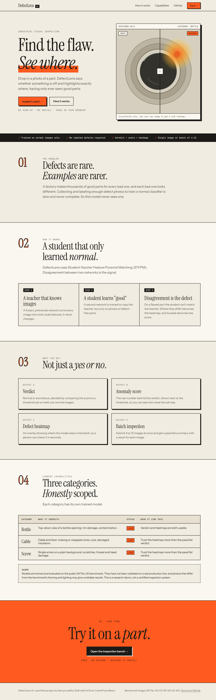
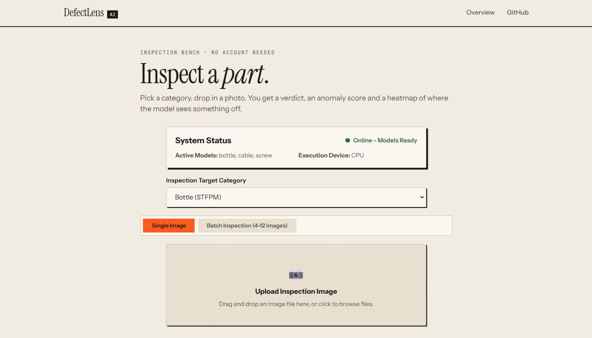
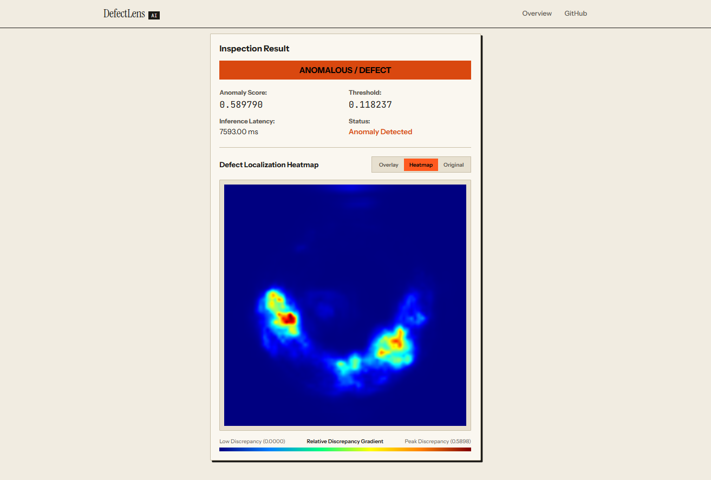
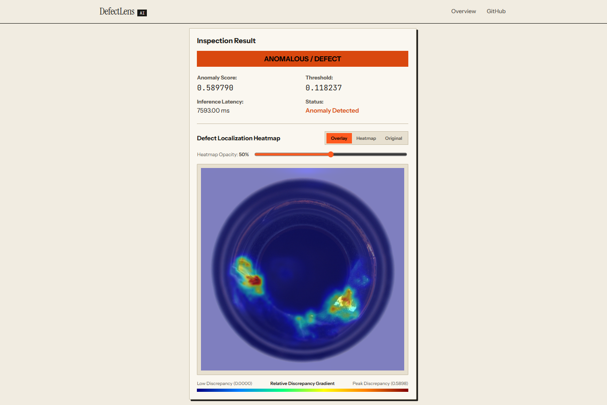
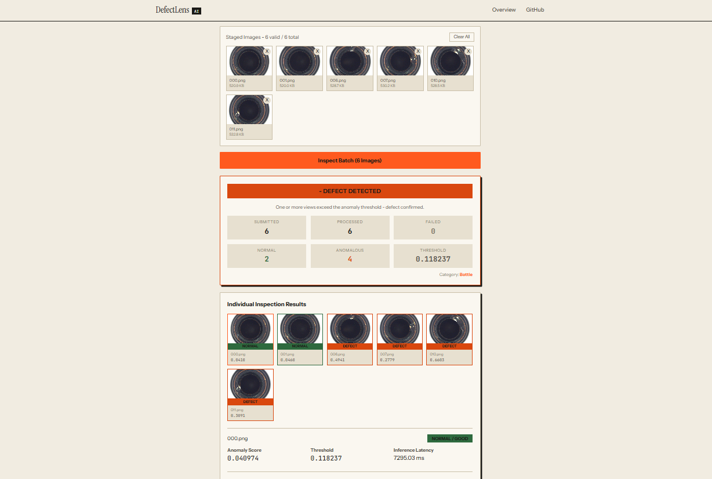

# DefectLens AI

DefectLens AI is an industrial visual inspection system that detects and localizes surface defects using a Student-Teacher Feature Pyramid Matching (STFPM) model built in PyTorch. It supports single-image and batch inspection and returns an anomaly score, a normal or defect verdict, and a pixel-level anomaly heatmap that shows where the defect is.

## Live Links

| Resource | Link |
| --- | --- |
| Live application (Vercel) | https://defect-lens-ai.vercel.app/ |
| Backend API (Render) | https://defectlens-ai-backend.onrender.com/ |
| Interactive API docs | https://defectlens-ai-backend.onrender.com/docs |
| Source code (GitHub) | https://github.com/SamyaLaddha/DefectLens-AI |

Note: the backend goes to sleep after a period of inactivity, so the first request after a long gap can take around a minute to respond. Later requests are fast.

## Screenshots

### Landing Page


### Category Selector


### Defect inspection with heatmap and overlay



### Batch inspection result


## Supported Categories

The system currently supports three MVTec AD categories:

- Bottle
- Cable
- Screw

## Dataset

The project uses the MVTec AD benchmark, a widely used dataset for unsupervised industrial anomaly detection. It contains high-resolution images of objects and textures, with defect-free training images and test images that include both normal samples and several types of real defects, along with pixel-level defect masks.

Only the Bottle, Cable, and Screw categories are used in this project.

How the data is used:

- Training uses normal (defect-free) images only. The model never sees a defect during training.
- Defective images are excluded from training and used for evaluation.
- A held-out split of normal images is used as a validation set for checkpoint selection, so the test set is not used to pick checkpoints.

## How STFPM Works

STFPM is an unsupervised anomaly detection method. Because real defects are rare and varied, it learns what normal looks like and flags anything that deviates from it.

1. Teacher and student networks. Two networks with the same architecture are used. The teacher is a ResNet18 with pretrained weights that stays frozen. The student is a ResNet18 that is trained to reproduce the teacher's feature maps.
2. Training on normal images. The student is trained only on defect-free images, so it learns to match the teacher on normal appearance.
3. Detection at inference. Both networks extract features from the input image at several layers. On normal regions the student and teacher features agree. On defective regions the student has never learned to match the teacher, so the features differ more.
4. Localization. The feature differences from multiple layers are combined into a pixel-level anomaly map, which is shown as the heatmap. The highest values in the map give the image-level anomaly score.
5. Verdict. The anomaly score is compared with a category-specific decision threshold to decide whether the image is normal or defective.

## Model and Training Configuration

| Parameter | Value |
| --- | --- |
| Model | STFPM |
| Backbone | ResNet18 |
| Optimizer | Adam |
| Learning rate | 0.0004 |
| Scheduler | CosineAnnealingLR |
| Maximum epochs | 100 |
| Early stopping patience | 10 |
| Training device | CPU |
| Threshold selection | Youden index |

Checkpoint selection uses validation loss on the held-out normal validation split. Decision thresholds are then chosen with the Youden index, which picks the threshold that maximizes the gap between true positive rate and false positive rate.

## Evaluation Metrics

| Metric | What it measures |
| --- | --- |
| Image AUROC | Ability to separate normal images from defective images |
| Pixel AUROC | Ability to separate normal pixels from anomalous pixels |
| PRO score | Quality of anomaly region localization across defect sizes |
| F1 score | Balance between precision and recall at the selected threshold |

## Results

Final test metrics for the selected checkpoint of each category:

| Category | Selected Run | Image AUROC | Pixel AUROC | PRO Score | F1 Score |
| --- | --- | --- | --- | --- | --- |
| Bottle | run_2 | 1.0000 | 0.9848 | 0.9519 | 1.0000 |
| Cable | run_3 | 0.6775 | 0.9361 | 0.8511 | 0.7111 |
| Screw | run_2 | 0.7645 | 0.9783 | 0.8913 | 0.8534 |

Selected checkpoint details:

| Category | Epochs Completed | Best Epoch | Decision Threshold |
| --- | --- | --- | --- |
| Bottle | 100 | 97 | 0.118237 |
| Cable | 100 | 99 | 0.226452 |
| Screw | 100 | 95 | 0.062461 |

### Honest Notes on Performance

- Bottle is close to perfect on every metric.
- Cable and screw localize defects well at the pixel level (pixel AUROC above 0.93), but image-level detection is weaker, especially for cable (image AUROC 0.6775). Image-level verdicts on these two categories should be treated with more caution than bottle.
- Decision thresholds were selected using the Youden index on the test set, which includes both normal and defective images. Consequently, threshold-dependent metrics such as F1, precision, and recall are likely optimistic. Image AUROC and Pixel AUROC are threshold-independent.

## API Documentation

| Method | Endpoint | Purpose |
| --- | --- | --- |
| GET | /api/health | Health check |
| GET | /api/categories | List the supported categories |
| POST | /api/predict | Inspect a single image |
| POST | /api/predict/batch | Inspect a batch of 4 to 12 images |

Full request and response schemas, with a try-it-out interface, are available in the interactive docs at https://defectlens-ai-backend.onrender.com/docs

## Tech Stack

| Layer | Technology |
| --- | --- |
| Frontend | React, Vite, custom CSS |
| Backend | FastAPI, PyTorch |
| Model | STFPM with ResNet18 backbone |
| Dataset | MVTec AD |
| Frontend hosting | Vercel |
| Backend hosting | Render (built from the backend Dockerfile) |
| Containerization | Docker |

## Project Structure

```
DefectLens-AI/
  backend/           FastAPI service, model code, and backend Dockerfile
  frontend/          React and Vite web application
  docs/screenshots/  Screenshots used in this README
  .gitignore
  README.md
```

## Local Setup

Run the backend and the frontend in two separate terminals. Local development uses port 8000 for the backend.

### 1. Backend

From the project root (Windows PowerShell):

```
cd backend
uvicorn app.main:app --reload --host 127.0.0.1 --port 8000
```

- Backend API: http://127.0.0.1:8000
- Swagger documentation: http://127.0.0.1:8000/docs

If you have not created the virtual environment yet, create it and install the backend dependencies first:

```
cd backend
python -m venv venv
.\venv\Scripts\Activate.ps1
pip install -r requirements.txt
```

### 2. Frontend

In a second terminal:

```
cd frontend
npm install
npm run dev
```

Vite prints the local frontend URL, usually http://localhost:5173.

### 3. Environment variable

The frontend reads the backend URL from `VITE_API_BASE_URL` in `frontend/.env`. For local development, point it to the local backend:

```env
VITE_API_BASE_URL=http://127.0.0.1:8000
```

Keep the `.env` file local and do not commit it.

## Docker

The backend is containerized. The image is named `defectlens-ai:latest` and is approximately 2.38 GB. It was built and tested locally with Docker Desktop and is not published on Docker Hub. On Render, the image is built directly from this GitHub repository using the backend Dockerfile.

Build the image from the project root:

```
docker build -t defectlens-ai:latest -f backend/Dockerfile backend
```

Run the container (the Docker backend uses port 7860):

```
docker run -p 7860:7860 defectlens-ai:latest
```

Then open http://localhost:7860/docs to see the API documentation.

## Deployment

- Frontend: deployed on Vercel at https://defect-lens-ai.vercel.app/
- Backend: deployed on Render at https://defectlens-ai-backend.onrender.com/, built from the backend Dockerfile in this repository and served on port 7860
- The frontend calls the backend over HTTPS

## Limitations and Future Improvements

Limitations:

- Only three MVTec AD categories are supported: Bottle, Cable, and Screw.
- Image-level detection is weak for Cable and moderate for Screw, even though their pixel-level localization is strong.
- MVTec AD is a controlled benchmark with consistent lighting and positioning. Performance on real factory images has not been tested.
- Decision thresholds were tuned on the test set, so threshold-based metrics such as F1 are likely optimistic.
- Training was done on CPU with Adam. This is a research and portfolio project, not a validated production inspection system.

Future improvements:

- Compare SGD with momentum against Adam, as used in the original STFPM paper, to try to improve image-level detection on Cable and Screw.
- Select decision thresholds on a separate validation set so that reported F1 is not optimistic.
- Extend support to more MVTec AD categories.

**Author:** Samya Laddha

**Connect with me:**
- LinkedIn: [Samya Laddha](https://www.linkedin.com/in/samya-laddha/)
- GitHub: [SamyaLaddha](https://github.com/SamyaLaddha)